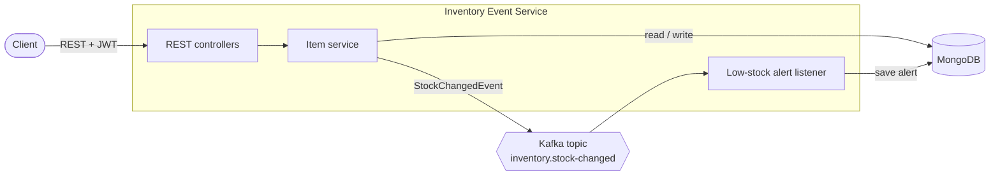

# Inventory Event Service

[](https://github.com/trident16/inventory-event-service/actions/workflows/ci.yml)


A backend service for tracking warehouse stock. Users record stock coming in and going out through a secured REST API. Every change is published to **Kafka** as an event, and a consumer raises **low-stock alerts** when an item runs low.

Built with **Java 17, Spring Boot 3, Spring Security (JWT), MongoDB, Apache Kafka and Docker**.

## Architecture



1. A signed-in user calls `POST /api/items/{id}/stock` to add or remove stock.
2. The service checks the business rules (stock can't go below zero), saves the new quantity in MongoDB, and publishes a `StockChangedEvent`.
3. The alert listener consumes the event. If the quantity just crossed the item's low-stock threshold, it stores an alert that users can see at `GET /api/alerts`.

## Features

- **REST API** for items, stock movements and alerts, with Bean Validation on every request
- **JWT authentication** with BCrypt-hashed passwords and two roles:

  | Action | USER | ADMIN |
  |---|:-:|:-:|
  | View items and alerts | ✅ | ✅ |
  | Record stock in/out | ✅ | ✅ |
  | Create, edit, delete items | ❌ | ✅ |

- **Event-driven alerts** over Kafka
- **Consistent error responses** using RFC 7807 Problem Details (400 / 401 / 403 / 404 / 409)
- **Optimistic locking** so concurrent stock updates can't overwrite each other
- **Docker Compose** setup that starts the app, MongoDB and Kafka with one command
- **CI** with GitHub Actions: build, tests and Docker image on every push

## Design decisions

- **Quantity only changes through stock movements.** `PUT /api/items/{id}` edits the name and threshold but not the quantity, so every stock change goes through one path that validates it and publishes an event.
- **Optimistic locking (`@Version`).** If two requests adjust the same item at the same time, the second one gets `409 Conflict` instead of silently overwriting the first (the "lost update" problem).
- **Stateless JWT.** The token carries the username and role, so any instance of the service can authorize a request without shared sessions or a database lookup.
- **Kafka message key = item id.** All events for one item go to the same partition, so they're consumed in order.
- **Idempotent consumer.** Kafka delivers at least once, so each event has a unique `eventId`, and the alert collection has a unique index on it. A redelivered event never creates a second alert.
- **Alerts fire on crossing the threshold**, not on every change while stock is low, to avoid alert spam.

## Getting started

### Run everything with Docker

Requires Docker Desktop.

```bash
git clone https://github.com/trident16/inventory-event-service.git
cd inventory-event-service
docker compose up --build
```

The API is available at `http://localhost:8080`. An admin account is created on startup (`admin` / `admin-dev-password`). Change it by setting `ADMIN_USERNAME`, `ADMIN_PASSWORD` and `JWT_SECRET` in a `.env` file.

### Run from your IDE

```bash
docker compose up mongodb kafka     # start only the infrastructure
mvn spring-boot:run                 # app connects to localhost:27017 and localhost:29092
```

### Run the tests

```bash
mvn verify
```

The tests don't need Docker: controllers are tested with MockMvc, services with Mockito, and the Kafka flow with an embedded Kafka broker.

## Using the API

```bash
# 1. Log in as admin and save the token
TOKEN=$(curl -s -X POST localhost:8080/api/auth/login \
  -H "Content-Type: application/json" \
  -d '{"username":"admin","password":"admin-dev-password"}' | jq -r .accessToken)

# 2. Create an item
curl -s -X POST localhost:8080/api/items \
  -H "Authorization: Bearer $TOKEN" -H "Content-Type: application/json" \
  -d '{"sku":"MOTOR-100","name":"Drive motor","quantity":10,"lowStockThreshold":3}'

# 3. Remove stock (use the id returned above)
curl -s -X POST localhost:8080/api/items/<id>/stock \
  -H "Authorization: Bearer $TOKEN" -H "Content-Type: application/json" \
  -d '{"type":"OUT","quantity":8,"reason":"Order #42"}'

# 4. Stock dropped from 10 to 2 (threshold 3), so an alert was raised
curl -s localhost:8080/api/alerts -H "Authorization: Bearer $TOKEN"
```

### Endpoints

| Method | Path | Who | Description |
|---|---|---|---|
| POST | `/api/auth/register` | Public | Create a USER account |
| POST | `/api/auth/login` | Public | Get a JWT |
| GET | `/api/items` | USER, ADMIN | List items |
| GET | `/api/items/{id}` | USER, ADMIN | Get one item |
| POST | `/api/items` | ADMIN | Create an item |
| PUT | `/api/items/{id}` | ADMIN | Update name and threshold |
| DELETE | `/api/items/{id}` | ADMIN | Delete an item |
| POST | `/api/items/{id}/stock` | USER, ADMIN | Record stock `IN` or `OUT` |
| GET | `/api/alerts` | USER, ADMIN | Open alerts (`?all=true` for history) |
| POST | `/api/alerts/{id}/acknowledge` | USER, ADMIN | Acknowledge an alert |
| GET | `/actuator/health` | Public | Health check |

Example error response:

```json
{
  "type": "about:blank",
  "title": "Conflict",
  "status": 409,
  "detail": "Cannot remove 5 units of MOTOR-100: only 2 in stock",
  "instance": "/api/items/6735f.../stock"
}
```

## Project structure

```
src/main/java/com/tarunnalla/inventory
├── item/       Item entity, REST controller, service, DTOs
├── events/     StockChangedEvent, Kafka publisher, topic config
├── alerts/     Kafka listener, alert storage and endpoints
├── auth/       Register and login endpoints
├── security/   JWT service and filter, Spring Security config, users
├── common/     Exceptions and global error handler
└── config/     MongoDB auditing
```

## What I'd add next

- **Transactional outbox**, so the database write and the Kafka publish can never get out of sync if the app crashes between them
- **Pagination and search** on `GET /api/items`
- **Testcontainers** integration tests against real MongoDB and Kafka
- **OpenAPI / Swagger UI** documentation
- **Dead-letter topic** for events that repeatedly fail processing

## Author

**Tarun Reddy Nalla**: [LinkedIn](https://www.linkedin.com/in/tarunreddynalla/) · [GitHub](https://github.com/trident16)
